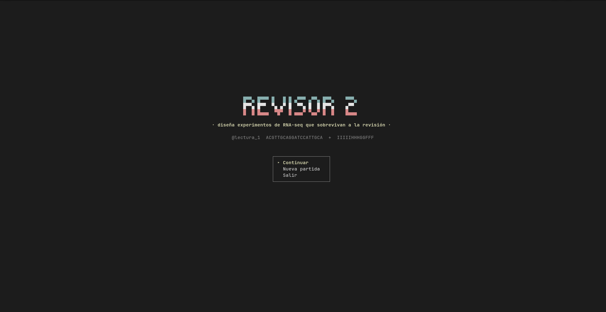
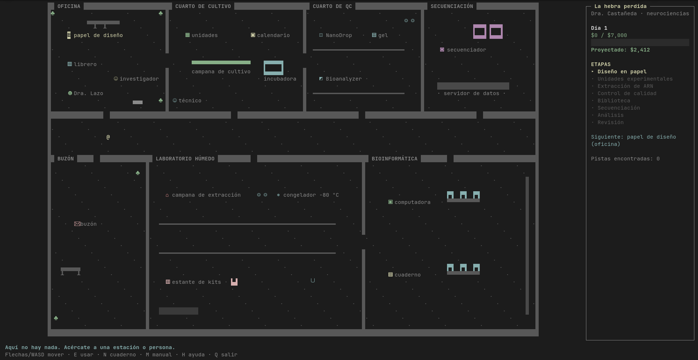
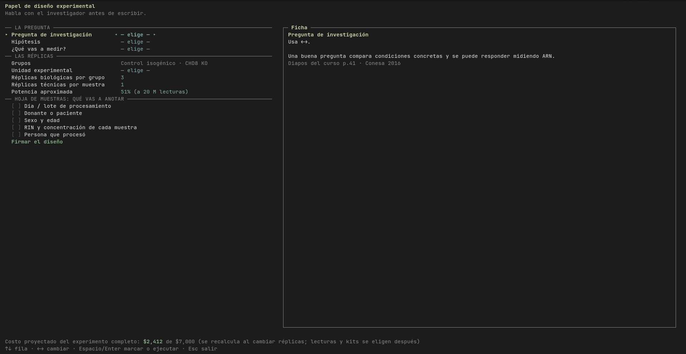

# REVISOR 2

*English: `revisor2 --en` or Options → Language.*

Juego de terminal para aprender a diseñar experimentos de RNA-seq. Cada caso es
un investigador con una pregunta, un presupuesto y un problema escondido. Haces
el experimento completo en un laboratorio que recorres, del diseño en papel al
análisis, y al final el Revisor 2 califica el manuscrito y el cuaderno.

Los errores se arrastran: un ARN degradado aprobado en el QC sale como ruido en
los resultados.

**Descargar:** [Windows](https://github.com/leomorgzzz/revisor2/releases/latest/download/Revisor2-Instalador-Windows.exe) · [macOS](https://github.com/leomorgzzz/revisor2/releases/latest/download/Revisor2-macOS.zip) · instala y a jugar.

## Capturas







## Instalación

### Windows

1. Descarga **[Revisor2-Instalador-Windows.exe](https://github.com/leomorgzzz/revisor2/releases/latest/download/Revisor2-Instalador-Windows.exe)** y ábrelo.
2. Sigue el instalador (no pide permisos de administrador). Al terminar, el
   juego queda en el menú Inicio y, si quieres, en el escritorio. Se abre en
   pantalla completa.

El instalador no está firmado (firmarlo cuesta una licencia anual), así que la
primera vez Windows puede avisar «Windows protegió su PC»: **Más información →
Ejecutar de todas formas**. Solo pasa al instalar. Para desinstalar:
**Configuración → Aplicaciones**.

### macOS

1. Descarga **[Revisor2-macOS.zip](https://github.com/leomorgzzz/revisor2/releases/latest/download/Revisor2-macOS.zip)** y ábrelo.
2. Doble clic en `Revisor2`. Si macOS no lo deja abrir: **Ajustes del Sistema →
   Privacidad y seguridad → Abrir de todos modos**.

Es para Mac con chip Apple (M1 o posterior).

### Linux o desde el código

```bash
git clone https://github.com/leomorgzzz/revisor2.git
cd revisor2
./instalar.sh        # crea el comando `revisor2` en ~/.local/bin
revisor2
```

Sin instalar: `python3 revisor2.py`. Quitar el comando: `./instalar.sh --quitar`.

Desde el código requiere Python 3 (solo biblioteca estándar; en Windows instala
`windows-curses` la primera vez). Funciona desde 80×24.

Archivos que crea:

- `~/.revisor2.json`: la partida (en Windows, `~` es `C:\Users\<tu usuario>`);
- `~/.revisor2_idioma`: el idioma;
- `~/Documentos/revisor2-protocolos/`: los protocolos exportados.

## Salir de pantalla completa

| Sistema | Tecla |
|---|---|
| Windows | Alt+Enter (o F11 en Windows Terminal) |
| macOS | Ctrl+Cmd+F |
| Linux | F11 en la mayoría de las terminales |

## Controles

| Tecla | Acción |
|---|---|
| Flechas / WASD | moverse |
| E / Enter | usar la estación o hablar |
| N | cuaderno de laboratorio y exportar protocolo |
| M / H | manual / ayuda |
| Q | salir (se guarda) |

## Menú

- **Jugar**: casos, laboratorio libre y capacitación.
- **Estudiar**: manual, catálogo de métodos y glosario.
- **Practicar**: repaso y examen.
- **Opciones**: dificultad, velocidad e idioma.

## Fuentes

Cada dato lleva su cita en `datos.FUENTES`: Conesa 2016, Schurch 2016, Liu
2014, Love 2014, Auer & Doerge 2010, Leek 2010, Lovén 2012, Squair 2021, entre
otras.
